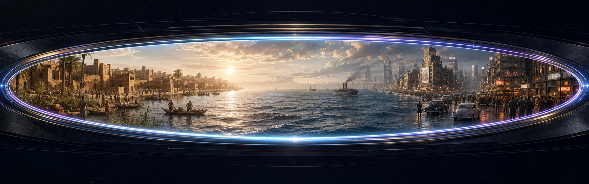

  

# OmniView - The Looking Glass Companion

> A wormhole camera is not a subject with a year stapled to it. It is a place to stand, a world to read, and a moment made visible.

OmniView turns natural requests such as "open a view onto Uruk around 3200 BC at first light" into grounded scene interpretations and image-ready prompts. When a host exposes an authorized image tool, OmniView can hand one complete prompt to it. When no image tool is available, the prompt remains the finished product.

**[Explore the product site](https://stunspot.github.io/omniview-looking-glass/)** | **[Download v0.1.1](https://github.com/Stunspot/omniview-looking-glass/releases/tag/v0.1.1)** | **[Open your first view](docs/USING-OMNIVIEW.md)**

OmniView is for visual researchers, storytellers, worldbuilders, historians, educators, artists, and curious people who want a place-time image without confusing a vivid reconstruction with documentary surveillance.

This repository contains two separate handoffs:

1. **OmniView companion Augment.** A portable skill for grounded single views, fixed-optic comparisons, traversals, copy-ready prompts, and optional authorized renders.
2. **Two bounded GL4SS drop-ins.** Planner and render-language patches for Pliny the Liberator's existing application. They do not add a model call, provider, dependency, storage layer, UI, or public TypeScript field.

Inspired by The Looking Glass / GL4SS by Pliny the Liberator; composed by stunspot and Nova. OmniView is an independent Collaborative Dynamics companion, not an official, endorsed, upstream, or replacement GL4SS release.

## What the product does

OmniView performs seven linked acts:

1. **Locate** the actual place, temporal precision, local hour, medium, and operation.
2. **Ground** land, water, ice, ecology, habitation, built world, and datable matter.
3. **Witness** from honest footing, an afloat optic, a safe standoff, or an explicitly virtual aperture.
4. **Compose** one focal event through foreground, middle distance, far distance, atmosphere, and light.
5. **Provoke** an image model with medium-native visual language instead of generic quality tags.
6. **Render or hand off** through an available authorized host tool, or return a complete copy-ready prompt.
7. **Account** for uncertainty, scenario assumptions, tool state, and actual dispatch.

It handles dense and uninhabited scenes, coarse and exact dates, open-ocean and vanished support, fixed-view comparisons, text-first traversals, declared future scenarios, and photographic or non-photographic media.

## What it cannot prove

OmniView does not recover literal images from the past or future. It cannot guarantee historical truth, exact absence, a famous event from a year alone, source availability, provider compatibility, rendered quality, universal host discovery, or that a requested dispatch returned an image.

Its three evidence registers remain visible:

- source-backed condition;
- bounded visual inference needed for a coherent ordinary scene;
- declared scenario choice.

Its tool states also remain separate: prompt-only, host-rendered, render-failed, and source-unavailable. A prompt is not a render. Dispatch is not a returned image. A generated reconstruction is not a primary source.

Read [Trust, privacy, and limits](docs/TRUST-PRIVACY-AND-LIMITS.md).

## Install and verify

The release contains:

- Codex folder: codex/omniview-looking-glass/
- Claude upload: claude/omniview-looking-glass.zip
- Claude upload and Claude Code source: claude/omniview-looking-glass.zip
- GL4SS patches: gl4ss-dropins/

Follow [Installation](docs/INSTALLATION.md) for exact paths, archive checks, and host-specific boundaries. After installation, start a fresh host session and explicitly invoke OmniView.

Use this behavioral acceptance request:

> Open a prompt-only view at Point Nemo in AD 1500 at 23:30 local time. The year is all I know.

A healthy result uses a declared virtual aperture over open water, composes ocean and broad night luminance, avoids invented land, vessels, exact weather, or lunar phase, and reports prompt-only with zero dispatches. This proves bounded behavior only when the host also shows that the installed skill supplied it.

Current evidence does not claim a fresh-host installation or selection receipt. See the [Host matrix](customer-kit/HOST-MATRIX.md).

## Begin successfully

Ask in ordinary language:

> Open a view onto Uruk around 3200 BC at first light. Text and prompt only.

> Compare the same street-level view in central Pripyat at 14:00 in 1985 and 2020. Text and prompts only.

> Build a five-stop traversal of this coastline. Tell me the render count before using any image tool.

A response normally contains the interpreted place and temporal precision, optic support, visible world, evidence class, composed view, complete Render Seed, and truthful tool state. See [Using OmniView](docs/USING-OMNIVIEW.md) for comparisons, traversals, media, future scenarios, inputs, and outputs.

## Customer journey

| Need | Go here |
|---|---|
| Choose the companion or GL4SS path | [Start here](customer-kit/START-HERE.md) |
| Install and verify | [Installation](docs/INSTALLATION.md) |
| Open views, compare, or traverse | [Using OmniView](docs/USING-OMNIVIEW.md) |
| Recover from a failure | [Troubleshooting](docs/TROUBLESHOOTING.md) |
| Update, remove, roll back, or clean data | [Lifecycle](docs/LIFECYCLE.md) |
| Understand privacy, sources, rendering, and limitations | [Trust, privacy, and limits](docs/TRUST-PRIVACY-AND-LIMITS.md) |
| Use a nonvisual workflow | [Accessibility](docs/ACCESSIBILITY.md) |
| Inspect package topology | [Package reference](docs/PACKAGE-REFERENCE.md) |
| Apply or reverse GL4SS patches | [GL4SS drop-ins](docs/GL4SS-DROPINS.md) |
| Inspect evidence | [Verification summary](customer-kit/VERIFICATION-SUMMARY.md) |
| Get help | [Support](SUPPORT.md) |
| Report a vulnerability | [Security policy](SECURITY.md) |
| Contribute | [Contributing](CONTRIBUTING.md) |
| Understand rights and relationship | [License](LICENSE.md), [Notice](NOTICE.md), [Trademarks](TRADEMARKS.md), and [Provenance](customer-kit/PROVENANCE.md) |

## Evidence status

Observed locally for the unchanged v0.1.0 behavior-bearing runtime packaged in public release v0.1.1:

- both bounded patches apply together to GL4SS commit ab4984597ecf3afbd8ea66309be5ed68ce429146;
- the patched candidate builds and lints;
- package validation passes with 12 portable files and Codex-Claude byte parity;
- all 17 source cards pass schema and internal-link checks;
- all 13 retained behavioral cases pass their frozen oracles;
- behavioral, adversarial, and evidence-custody reviews report PASS WITH RESIDUAL RISK.

Not established: fresh-host installation or selection, live image-tool dispatch and returned-image custody, provider compatibility, rendered superiority, repeated stochastic reliability, or fresh external revalidation of every source card.

The complete boundaries and evidence commits are in [Verification summary](customer-kit/VERIFICATION-SUMMARY.md).

## Publication, license, and support

Public release v0.1.1 carries the unchanged v0.1.0 behavior-bearing runtime and uses the Collaborative Dynamics split license for original OmniView material; the GL4SS-derived drop-ins remain AGPL-3.0-or-later. Publication does not imply upstream acceptance, provider execution, or endorsement by Pliny.

Use [GitHub Issues](https://github.com/Stunspot/omniview-looking-glass/issues) for privacy-safe reproducible defects. Security-sensitive reports follow [SECURITY.md](SECURITY.md). No automatic updater, telemetry service, or support SLA is included.
