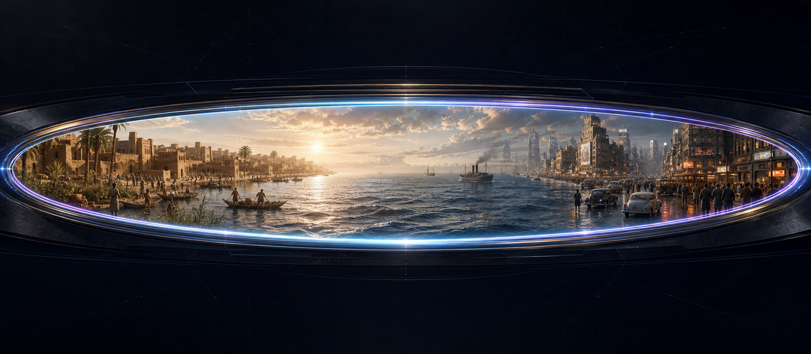

  

Agent-operated place-time camera

# Stand somewhere real. See the world that moment earns.

OmniView turns an ordinary request into a physically coherent place-time view and a complete image-ready prompt. When the host exposes an authorized renderer, it can dispatch one image and report the observed result. When no renderer is available, the prompt remains the finished product.

<a class="button primary" href="https://github.com/Stunspot/omniview-looking-glass/releases/tag/v0.3.1">Download v0.3.1</a>
<a class="button secondary" href="./INSTALLATION.html">Install OmniView</a>
<a class="button secondary" href="./USING-OMNIVIEW.html">Open a first view</a>

OmniView is for visual researchers, storytellers, historians, educators, artists, worldbuilders, and curious people who want vivid reconstruction without pretending that geography is surveillance or that a year selects a famous event.

## The product loop

<article class="product-card">
Locate and ground
<h3>Reconstruct the actual coordinate</h3>
Place, time resolution, land, water, ecology, habitation, structure lifecycle, and source limits determine the world class.
</article>
<article class="product-card">
Witness and compose
<h3>Use an honest optic</h3>
Physical footing, afloat support, safe standoff, or a declared virtual aperture anchors one material event through depth and light.
</article>
<article class="product-card">
Prompt or render
<h3>Keep tool state truthful</h3>
Return a complete Render Seed, optionally dispatch through an authorized host tool, and distinguish prompt-only, host-rendered, render-failed, and source-unavailable.
</article>

## Inputs and outputs

Give OmniView a place or coordinate, date or period, and the view you want. Add a local hour, fixed camera, medium, comparison, traversal, or future scenario when it matters.

A complete result can include:

- interpreted place, temporal precision, and local hour;
- physical or virtual optic and support relation;
- source-backed conditions, bounded visual inference, and scenario assumptions;
- a compact witnessed View;
- a complete copy-ready Render Seed;
- comparison invariants or an ordered traversal plan;
- intended render count before a multi-image route;
- one truthful render state and an observed output reference only when returned.

## Start with a bounded success

> Open a prompt-only view onto Uruk around 3200 BC at first light. Separate sourced conditions from scene inference.

Prompt-only performs the whole grounding and composition path without an external image dispatch. It is the cleanest first acceptance check.

For open water, try:

> Open a prompt-only view at Point Nemo in AD 1500 at 23:30 local time. The year is all I know.

A healthy view uses a declared virtual aperture over water, preserves the unresolved calendar, and invents neither land nor an exact moon phase.

## Two public handoffs

<article class="product-card">
Companion Augment
<h3>Codex and Claude</h3>
Portable skill artifacts for single views, comparisons, traversals, prompts, and optional host renders.

<a href="./INSTALLATION.html">Install and verify</a>
</article>
<article class="product-card">
GL4SS drop-ins
<h3>Bounded maintainer patches</h3>
Two AGPL-derived patches against one frozen GL4SS commit. They preserve providers, UI, storage, model-call count, dependencies, and public TypeScript contracts.

<a href="./GL4SS-DROPINS.html">Apply or reverse safely</a>
</article>
<article class="product-card">
Evidence
<h3>Claims with altitude</h3>
Package, corpus, patch, release, and retained behavior have bounded receipts. Fresh-host selection and rendered superiority do not.

<a href="https://github.com/Stunspot/omniview-looking-glass/blob/main/customer-kit/VERIFICATION-SUMMARY.md">Read verification</a>
</article>

## Boundaries that matter

OmniView composes reconstructions and scenarios; it does not recover documentary pixels from another time. A prompt is not a render. Dispatch is not a returned image. A year does not select an exact day, season, moon phase, weather event, or famous incident. Source-backed condition, bounded inference, and scenario remain distinct.

The package contains no image model, provider account, API key, telemetry client, hidden network service, or automatic updater. Hosts, research tools, and image providers have their own storage, logging, network, billing, and accessibility boundaries.

<a class="button primary" href="./TRUST-PRIVACY-AND-LIMITS.html">Read trust and limits</a>
<a class="button secondary" href="./TROUBLESHOOTING.html">Recover from failures</a>

## Continue the journey

- [Install and verify the companion](./INSTALLATION.html)
- [Open views, compare moments, and plan traversals](./USING-OMNIVIEW.html)
- [Update, remove, roll back, and clean up](./LIFECYCLE.html)
- [Use the nonvisual text-first workflow](./ACCESSIBILITY.html)
- [Inspect package topology](./PACKAGE-REFERENCE.html)
- [Get support](./SUPPORT.html)
- [Read license, relationship, and provenance](https://github.com/Stunspot/omniview-looking-glass/blob/main/customer-kit/PROVENANCE.md)
